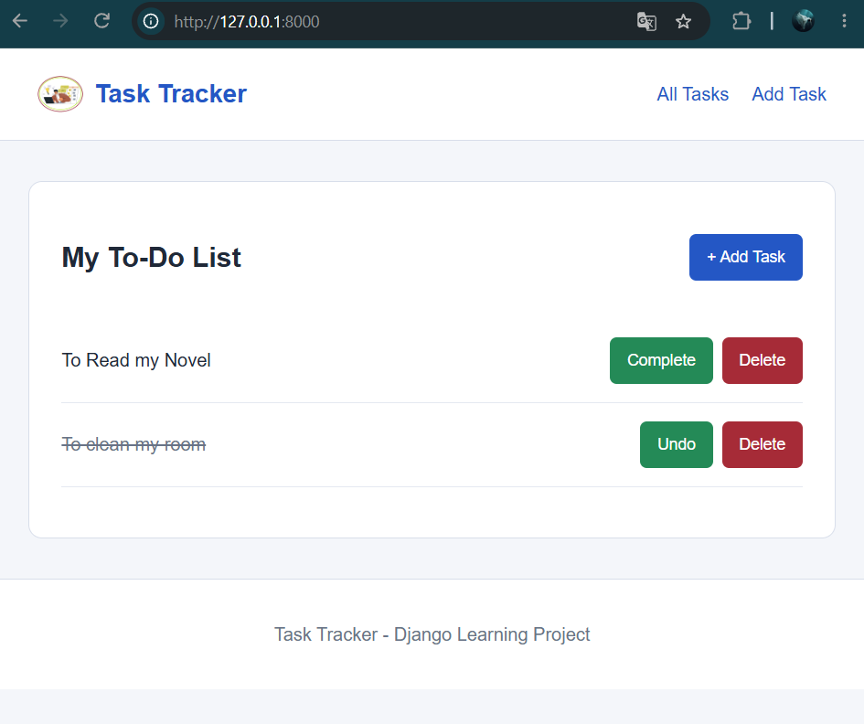
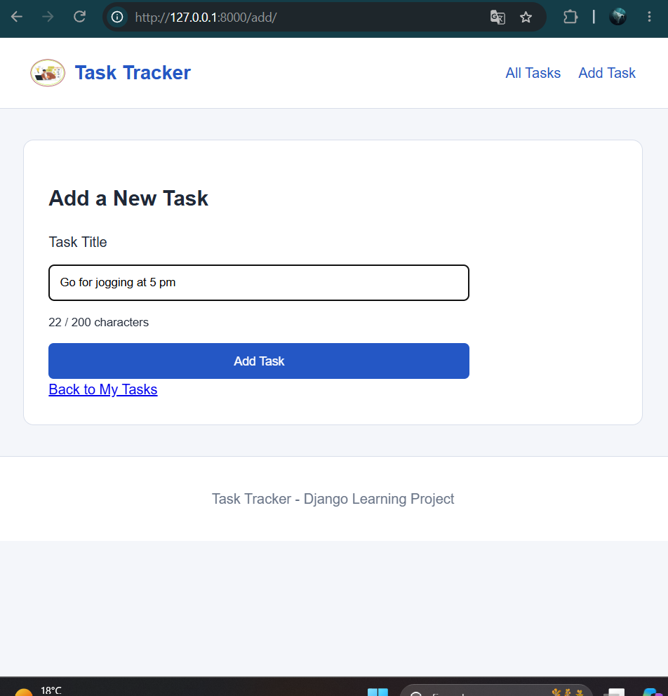
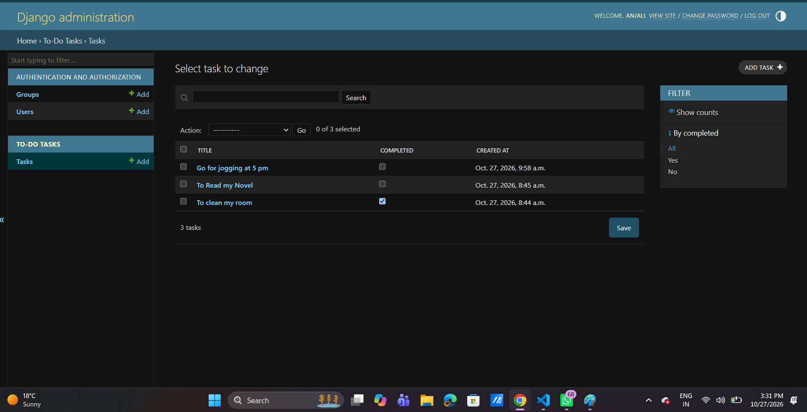

# Experiment 15: Django To-Do Application

## Aim
To develop a To-Do application using Django and SQLite that demonstrates CRUD operations, Django's MVT architecture, static file management, and reusable HTML templates.

## Concepts Covered
- Django project and application structure
- Model-View-Template (MVT) architecture
- Django ORM and SQLite database
- URL routing and HTTP requests
- Database migrations
- CRUD operations
- Django administration
- CSRF protection
- Static files and CSS
- Template inheritance using ``
- Reusable templates using ``

## Technologies Used
- **Python:** Backend programming language
- **Django:** Web framework
- **SQLite:** Database
- **HTML/CSS:** Frontend interface
- **VS Code:** Development environment

## Setup and Installation

1. Open the Experiment 15 folder in VS Code.
2. Create and activate a virtual environment.
3. Install dependencies using:

   `pip install -r requirements.txt`

4. Apply database migrations:

   `python manage.py migrate`

5. Start the development server:

   `python manage.py runserver`

6. Open `http://127.0.0.1:8000/` in a browser.

## File Structure

- `todo_project/` — Project configuration and routing
- `todo/models.py` — Task database model
- `todo/views.py` — CRUD implementation
- `todo/urls.py` — Application routes
- `todo/admin.py` — Admin model registration
- `todo/templates/todo/` — HTML templates
- `todo/static/todo/` — CSS stylesheet
- `manage.py` — Django command-line utility
- `requirements.txt` — Python dependencies

## Code and Route Explanation

| Route | Function | Description |
|---|---|---|
| `/` | `task_list` | Displays all tasks |
| `/add/` | `add_task` | Creates a new task |
| `/toggle/<task_id>/` | `toggle_task` | Updates completion status |
| `/delete/<task_id>/` | `delete_task` | Removes a task |
| `/admin/` | Django Admin | Manages database records |

## Additional Lab Assignment

### Static Files
A CSS stylesheet is stored inside `todo/static/todo/`. Django's `` tag and `` helper load this file into the HTML layout.

### Template Inheritance
The `base.html` file defines the common page structure. Other templates use `` and `` to reuse the layout.

### Template Inclusion
The `_task_item.html` template is reused inside `task_list.html` using ``.

## Expected Output
The application provides a user interface to:
- Add tasks
- Display saved tasks
- Mark tasks completed or incomplete
- Delete tasks
- Manage task records through Django Admin

Tasks are stored persistently in SQLite.

## Learning Outcomes
This experiment demonstrates how Django connects URL routes, views, models, HTML templates and static resources to create a functional database-driven web application.

## Conclusion
A Django To-Do application was developed with CRUD operations using SQLite and Django ORM. The experiment also demonstrated static file serving, template inheritance, reusable components and Django administration.

## Additional Implementation — Experiment 15 (Version 2)

### 1. Reusable Templates
- Created `base.html` as the common page layout.
- Created separate `header.html` and `footer.html` components.
- Used `` for template inheritance.
- Used `` to reuse common components.
- Implemented a page-specific `extra_js` block.

### 2. Static Files
- Integrated external CSS for styling and responsive design.
- Added JavaScript for input autofocus.
- Implemented a task-title character counter.
- Added a logo using Django's static file system.

### 3. Django Admin Customization
- Registered the Task model using `TaskAdmin`.
- Added task search functionality.
- Implemented completion-status filtering.
- Enabled editing task completion status directly from the admin list.

### 4. Testing
Verified CRUD operations, SQLite persistence, CSRF protection, reusable templates, static asset loading, and responsive layout.

### 5. Output Screenshots

**Home Page**

**Add Task Page**

**Django Admin**

